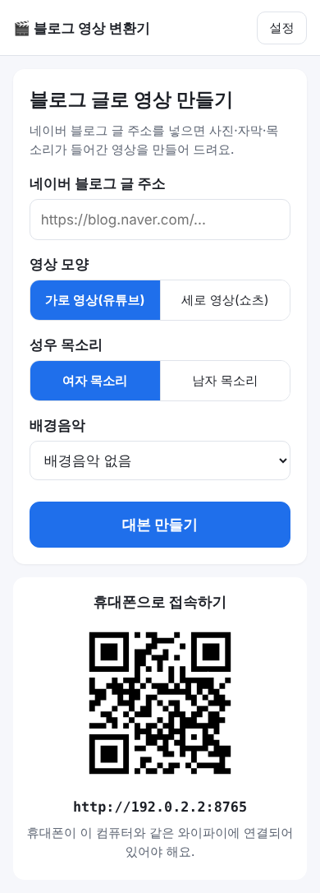
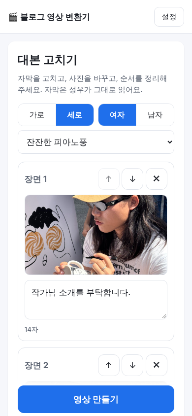
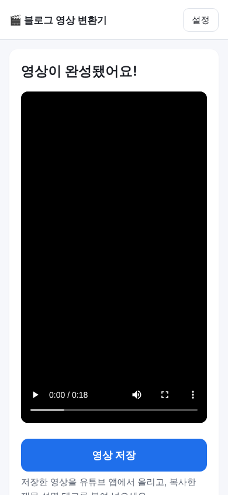

# 블로그 영상 변환기 사용 설명서

네이버 블로그 글 주소만 넣으면, 블로그 사진 위에 큰 자막과 AI 성우 목소리, 배경음악이 들어간 영상을 만들어 주는 프로그램입니다.

---

## 1. 설치하기 (처음 한 번)

1. 받은 파일 **`BlogVideo-Setup.exe`** 를 더블클릭합니다.
2. 파란 창에 **"Windows의 PC 보호"** 라는 경고가 뜰 수 있어요. 이상한 프로그램이 아니에요. 아래처럼 하면 됩니다.
   - **"추가 정보"** 글자를 누릅니다.
   - 아래에 나오는 **"실행"** 버튼을 누릅니다.
3. "이 앱이 디바이스를 변경할 수 있도록 허용하시겠어요?" 라고 물으면 **"예"** 를 누릅니다.
4. **다음 → 설치 → 마침** 을 차례로 누르면 끝이에요.
   바탕화면에 **"블로그 영상 변환기"** 아이콘이 생깁니다.

> 받은 설치 파일에 필요한 설정이 이미 들어 있어요. 설치만 하면 바로 쓸 수 있어요.

---

## 2. 실행하기

- 바탕화면의 **"블로그 영상 변환기"** 아이콘을 더블클릭합니다.
- 잠시 뒤 **프로그램 창**이 열립니다. (주소창이나 탭이 없는 앱 창이에요)
- 창을 닫으면 프로그램도 꺼져요. 영상을 만드는 중이었다면 다 만든 뒤에 꺼져요.
- 창을 최소화해 두는 건 괜찮아요.

---

## 3. 이 컴퓨터에서만 써요

이 프로그램은 **설치한 컴퓨터에서만** 열려요. 휴대폰이나 다른 컴퓨터에서는 접속할 수 없어요.
그래서 같은 와이파이를 쓰는 다른 사람도 이 프로그램을 쓸 수 없어요.

---

## 4. 영상 만들기

### ① 주소 넣고 AI로 대본 만들기
1. 인터넷에서 영상으로 만들 네이버 블로그 여행 글을 열고, 위쪽 **주소창의 주소를 복사**합니다.
2. 프로그램의 **"네이버 블로그 글 주소"** 칸에 붙여 넣습니다.
3. 필요하면 **대본 설정**을 고릅니다: 대본 스타일(시네마틱 여행 다큐 / 일상 브이로그 / 여행 정보 전달 / 감성 여행 에세이 / 맛집·관광지 리뷰),
   목표 길이(기본은 글 내용 전부), 말투, 장소 소개를 얼마나 자세히 할지, 감성과 정보의 비율. 고른 값은 다음에도 그대로 남아요.
4. **"AI로 대본 만들기"** 를 누르면 AI가 먼저 여행을 분석(장소·일정·에피소드)한 뒤 AI가 글과 **사진을 직접 보고** 사진과 내용이 맞는 대본을 바로 써 줘요. (보통 20초~1분)

AI 없이 사진과 글을 직접 골라 만들고 싶으면 아래의 작은 **"AI 없이 직접 작성하기"** 를 누르세요.
글과 사진만 불러온 뒤, **"블로그 글·사진에서 가져오기"** 에서 글 한 토막이나 사진을 눌러 장면을 하나씩 만들면 돼요.

> "크레딧이 부족해요" 같은 오류가 나면 Anthropic 콘솔에서 결제 상태를 확인한 뒤 **다시 시도**를 눌러 주세요.

### ② 대본 고치기
맨 위 **"AI 여행 분석 보기"** 를 열면 AI가 정리한 장소·일정·에피소드가 보여요. 옆의 표시는
"글에 나옴"(글에 적혀 있음), "사진에서 봄"(사진으로만 확인), "추론"(AI가 짐작한 것)이에요.
받지 못한 사진이나 겹치는 사진이 있으면 노란 칸에 알려 줘요.

어느 방법으로 시작했든 이 화면에서 마음대로 고칠 수 있어요. 맨 위에서 **영상 프리셋**(시네마틱 여행 다큐 / 감성 브이로그 / 정보 전달형 / 사진 중심 에세이)을 고르면
스타일·전환·제목 띠가 한 번에 맞춰져요. 그다음 하나씩 바꿔도 돼요. **영상 스타일**(깔끔/감성/브이로그/시네마/에세이),
**가로·세로·정사각형**, **화질**, **성우 목소리**, **배경음악**을 고릅니다.

**성우 목소리**: 한국어 목소리 6가지와 다국어 목소리 7가지 중에서 고르고, 말하는 속도(느리게/보통/빠르게)도 정해요.
"미리 듣기"로 들어 보고 고르세요. 다국어 목소리는 한국어 억양이 조금 다를 수 있어요.

**배경음악**: 둘 중 하나를 골라요.
- **샘플·내 음악**: 들어 있는 샘플 음악이나 전에 추가한 음악을 목록에서 골라요. "미리 듣기"로 들어 볼 수 있어요.
- **유튜브 링크**: 유튜브 영상 주소를 넣고 "음악 가져오기"를 누르면 그 영상의 소리가 배경음악으로 들어가요.
  한 번 가져온 음악은 목록에 남아서 다음에도 쓸 수 있어요.
  ⚠️ 직접 만든 음악이나 사용이 허락된 음악(유튜브 오디오 보관함, 저작권 없는 음악 등)만 써 주세요.
  허락받지 않은 음악을 넣으면 올린 영상이 차단되거나 수익이 막힐 수 있어요.

**영상 길이**: 블로그 글 내용이 **전부** 장면으로 들어가요(길이 제한 없음). 글이 길면 영상도 길어져요.
장면 목록 위에 "장면 몇 개 · 예상 길이"가 나오니, 너무 길면 필요 없는 장면을 ✕로 지우고, 더 넣고 싶으면 "+ 장면 추가"로 넣으세요.
긴 영상은 만드는 데 시간이 걸려요(5분짜리 영상이면 몇 분~10분쯤).

**연출을 말로 요청하기**
- 화면 위쪽의 **영상 전체 연출 요청** 칸: 영상 전체에 바라는 것을 적어요. (예: 전체적으로 잔잔하고 감성적으로, 배경음악은 작게)
- 장면 카드의 **연출 요청 더 보기**를 열면 나오는 **연출 요청** 칸: 그 장면에 바라는 것을 적어요. (예: 천천히 확대하면서 따뜻한 색감으로, 자막 크게)
- **영상 만들기**를 누르면 AI가 요청을 읽고 사진 움직임과 세기, 장면 전환, 색감(따뜻하게·시원하게·흑백·선명하게·부드럽게),
  자막 크기와 위치, 장면이 머무는 시간을 맞춰 줘요. "더 짧게 써 줘", "재밌게 바꿔 줘"처럼 적으면 **그 장면의 자막 글도** 고쳐 줘요.
  요청을 적지 않은 장면의 글은 바뀌지 않아요.
- 만든 뒤 "대본 고쳐서 다시 만들기"로 돌아오면 장면마다 **"AI 연출: 따뜻한 색감 · 자막 크게 …"** 처럼 AI가 정한 내용이 보여요.
  마음에 안 들면 **되돌리기**를 누르거나 요청을 고쳐서 다시 만들면 돼요. 요청을 그대로 두고 다시 만들면 AI를 또 부르지 않아요.
- 동영상 넣기, 스티커, 음악 바꾸기처럼 프로그램에 없는 기능은 요청해도 반영되지 않아요.

**장면을 자유롭게 넣고 빼기**
- 장면 카드 아래의 **+ 앞에 추가 / + 뒤에 추가**: 그 장면 앞이나 뒤에 빈 장면을 끼워 넣어요.
- **복제**: 같은 장면을 하나 더 만들어요. **나누기**: 자막에서 커서를 둔 자리에서 장면을 둘로 나눠요.
- 장면을 한 번 눌러 고르면(파란 테두리), "블로그 글·사진에서 가져오기"에서 누른 글·사진이 **그 장면 바로 아래**에 들어가요.
- 사진에는 블로그에 올린 순서대로 **번호**가 붙어 있고, 이미 쓴 사진에는 "사용 중" 표시가 나와요.

**만드는 중에 멈추기**: "영상 만드는 중" 화면의 **영상 만들기 멈추기**를 누르면 바로 멈추고 대본 고치기 화면으로 돌아가요.
지금까지 만든 부분은 버려지고, 다시 "영상 만들기"를 누르면 처음부터 만들어요(이어서 만들기는 없어요).

장면마다 고칠 수 있는 것:
- **사진**: 사진을 눌러 다른 사진으로 바꿔요.
- **자막**: 성우가 그대로 읽어요.
- **장소 이름**: 넣으면 화면 왼쪽 위에 위치 표시와 함께 나와요.
- **움직임**: 사진이 천천히 확대·축소되거나 좌우·위아래로 움직여요. "자동"이면 프로그램이 알아서 골라요.
- **전환**: 앞 장면에서 이 장면으로 넘어올 때의 효과예요(겹치기, 밀기, 원으로 열기 등).
- **"작성 방법 다시 고르기"** 를 누르면 AI로 다시 쓰거나 직접 작성으로 바꿀 수 있어요(지금 장면은 지워져요).

여행 영상에 들어가는 것들도 이 화면에서 고칠 수 있어요.
- **여행 제목**: 영상 첫 화면, 왼쪽 위 제목 띠, 썸네일에 들어가요. 짧을수록 보기 좋아요. (예: 통영 1박 2일 여행)
- **시작 화면 둘째 줄**: 지역·기간 같은 한 줄. 비워 두어도 돼요.
- **장소 이름**: 장면마다 넣으면 화면 왼쪽 위에 위치 표시와 함께 나와요. 비워 두면 안 나와요.
- **시작 화면 / 끝 화면 / 제목 띠**: 필요 없으면 체크를 끄면 돼요.
- 끝 화면과 썸네일의 **채널 이름**은 **설정 → 채널 이름**에서 넣어요. 비워 두면 블로그 이름이 들어가요.

영상이 완성되면 결과 화면에서 **썸네일 저장**을 눌러 미리보기 이미지도 함께 받을 수 있어요.

- 장면마다 **자막**을 고칠 수 있어요. 성우가 자막을 그대로 읽어요.
- **사진**을 누르면 그 글의 다른 사진으로 바꿀 수 있어요.
- **↑ ↓** 로 순서를 바꾸고, **✕** 로 장면을 지울 수 있어요.
- 맨 아래에서 **유튜브 제목·설명·태그**도 고칠 수 있어요.
- 자막이 40자를 넘으면 주황색으로 알려 줘요. 짧을수록 보기 좋아요.

**AI로 고치기** (장면 카드의 파란 버튼): 그 장면의 글만 AI가 고쳐 줘요.
"자연스럽게", "유튜버 말투", "감성 더하기", "과장 줄이기", "30% 줄이기", "조금 길게", "경험이 드러나게", "친근하게", "정중하게" 중에서
고르거나, 원하는 것을 직접 적고 **고치기**를 누르세요. 지우는 부분은 빨간색, 새로 들어가는 부분은 초록색으로 보여 주고,
**바꾸기**를 눌러야 적용돼요. 다른 장면은 바뀌지 않아요.
- **AI로 전체 고치기**: 모든 장면의 말투나 길이를 한꺼번에 바꿔요. 장면마다 골라서 적용할 수 있어요.
- **맞춤법·문맥 검사**: 띄어쓰기·맞춤법·어색한 문장을 찾아 줘요. 고칠 곳만 골라 바꾸세요.
- **전체 대본 보기**: 대본 전체를 한눈에 봐요. 문장을 누르면 그 장면으로 가요.
- **버전 기록**: AI가 대본을 쓰거나 고치기 전, 대본을 확정할 때 저절로 남아요. 예전 버전으로 언제든 되돌릴 수 있어요.
- 고친 내용은 **저절로 저장**돼요(오른쪽 위 "저장됨 ✓"). 프로그램을 껐다 켜도 남아 있어요.

**사진 다루기**
- **사진 자동 맞추기**: AI가 장면마다 글과 사진이 맞는 정도를 점수로 매기고, 더 맞는 사진을 추천해요. 바꿀 장면만 골라 적용하세요.
  점수가 낮은 장면에는 "⚠ 글과 사진이 잘 안 맞을 수 있어요"와 추천 사진이 보여요. 추천 사진을 누르면 바로 바뀌어요.
- **+ 사진 더하기**: 한 장면에서 사진을 여러 장(최대 7장) 이어서 보여 줘요. 장면 카드의 작은 사진 ✕로 뺄 수 있어요.
- **사진별 시간**: 사진이 여러 장이면 사진마다 몇 초 보여 줄지 고를 수 있어요. "자동"은 남은 시간을 똑같이 나눠요.
  정한 시간이 목소리보다 길면 그 장면이 조금 길어져요.
- **사진 빼기**: 사진 고르기 창에서 사진 아래의 **빼기**를 누르면 그 사진은 영상에 쓰지 않아요(AI도 고르지 않아요). **되살리기**로 되돌려요.
- 사진 고르기 창 위의 **풍경·음식·카페…** 버튼으로 AI가 분류한 종류별로 볼 수 있어요.

**다시 만들 때는 빨라요**: 영상을 만든 뒤 글 한두 곳만 고쳐 다시 만들면, 바뀌지 않은 장면과 목소리는 그대로 다시 써서
처음보다 훨씬 빨리 끝나요(완성 화면에 몇 장면을 새로 만들었는지 보여 줘요). 스타일·화질·가로세로를 바꾸면 모두 새로 만들어요.

### ③ 대본 확정하고 영상 만들기
대본을 끝까지 확인했으면 **대본 확정**을 누르세요. 확정한 대본만 영상으로 만들어요.
확정한 뒤에 글을 고치면 다시 확정해야 해요. 아래의 **"대본 확정하고 영상 만들기"** 를 누르면 확정과 영상 만들기를 한 번에 해요.
- **"영상 만들기"** 를 누르면 진행 막대가 나와요. 보통 1~3분 걸려요.
- 기다리는 동안 화면을 닫아도 괜찮아요. 다시 열면 이어서 보여 줘요.

### ④ 저장하고 유튜브에 올리기

1. **"영상 저장"** 을 누르면 컴퓨터의 **"다운로드" 폴더**에 영상 파일이 저장돼요.
2. 인터넷에서 **유튜브 스튜디오**(studio.youtube.com)를 열고 **만들기 → 동영상 업로드** 에서 저장한 영상을 고릅니다.
3. 프로그램으로 돌아와 **"제목 복사"** 를 누르고 유튜브 제목 칸에 붙여 넣습니다.
   **설명**, **태그**도 같은 방법으로 붙여 넣으세요.
4. 유튜브에서 **업로드**를 누르면 끝!

다른 글로 또 만들려면 **"새 영상 만들기"** 를 누르세요.

---

## 5. 이럴 땐 이렇게 하세요

| 이런 문제가 생기면 | 이렇게 해 보세요 |
|---|---|
| 화면이 안 열려요 | 바탕화면 아이콘을 한 번 더 눌러 주세요. 그래도 안 되면 컴퓨터를 다시 켜 주세요. |
| "글을 읽을 수 없어요" | 블로그 글이 **전체공개**인지 확인해 주세요. 이웃공개·비공개 글은 읽을 수 없어요. |
| "네이버 블로그 글 주소를 넣어 주세요" | 블로그 **글 하나의 주소**를 넣어 주세요. 블로그 첫 화면 주소는 안 돼요. |
| "설정에서 API 키를 확인해 주세요" | 알려 주신 분께 연락해 주세요. 키를 다시 넣어야 해요. |
| "인터넷 연결을 확인해 주세요" | 컴퓨터가 인터넷에 연결되어 있는지 확인하고 **"다시 시도"** 를 눌러 주세요. |
| "프로그램을 시작하지 못했어요" | 컴퓨터를 다시 켠 뒤 아이콘을 눌러 주세요. |

---

## 6. 지우기

**설정 → 앱 → 설치된 앱** 에서 **"블로그 영상 변환기"** 를 찾아 **제거**를 누르면 돼요.

## AI 모델 고르기 (설정)
**설정 → AI 모델**에서 작업마다 쓸 Claude 모델을 고를 수 있어요. 처음 값이 추천 값이라 보통은 바꾸지 않아도 돼요.
- **연결 확인**을 누르면 고른 모델들을 아주 짧게 불러 보고 쓸 수 있는지 알려 줘요(아주 적은 비용이 들어요).
- 비싼 모델(Opus)일수록 글을 잘 쓰지만 비용이 더 들어요.
