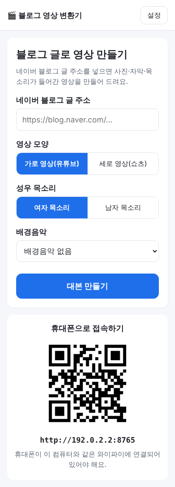
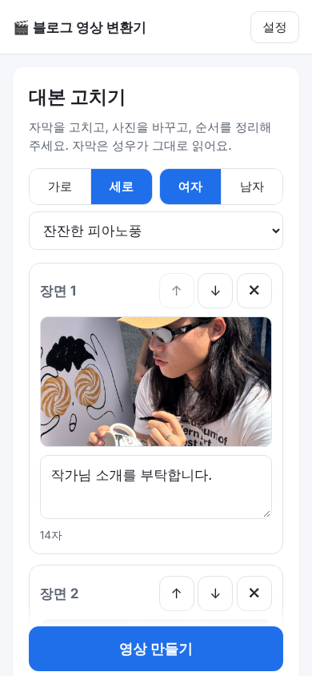
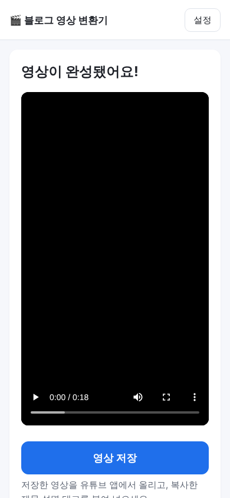

# 블로그 영상 변환기 사용 설명서

네이버 블로그 글 주소만 넣으면, 블로그 사진 위에 큰 자막과 AI 성우 목소리, 배경음악이 들어간 영상을 만들어 주는 프로그램입니다.

---

## 1. 설치하기 (처음 한 번)

1. 받은 파일 **`BlogVideo-Setup.exe`** 를 더블클릭합니다.
2. 파란 창에 **"Windows의 PC 보호"** 라는 경고가 뜰 수 있어요. 이상한 프로그램이 아니에요. 아래처럼 하면 됩니다.
   - **"추가 정보"** 글자를 누릅니다.
   - 아래에 나오는 **"실행"** 버튼을 누릅니다.
3. "이 앱이 디바이스를 변경할 수 있도록 허용하시겠어요?" 라고 물으면 **"예"** 를 누릅니다.
4. **다음 → 설치 → 마침** 을 차례로 누르면 끝이에요.
   바탕화면에 **"블로그 영상 변환기"** 아이콘이 생깁니다.

> 받은 설치 파일에 필요한 설정이 이미 들어 있어요. 설치만 하면 바로 쓸 수 있어요.

---

## 2. 실행하기

- 바탕화면의 **"블로그 영상 변환기"** 아이콘을 더블클릭합니다.
- 잠시 뒤 인터넷 창(브라우저)이 열리면서 프로그램 화면이 나옵니다.
- 창을 닫아도 프로그램은 뒤에서 계속 켜져 있어요. 아이콘을 다시 누르면 화면이 다시 열립니다.
- 컴퓨터를 껐다 켜면 아이콘을 다시 눌러 주세요.

---

## 3. 이 컴퓨터에서만 써요

이 프로그램은 **설치한 컴퓨터에서만** 열려요. 휴대폰이나 다른 컴퓨터에서는 접속할 수 없어요.
그래서 같은 와이파이를 쓰는 다른 사람도 이 프로그램을 쓸 수 없어요.

---

## 4. 영상 만들기

### ① 글 주소 넣기
1. 인터넷에서 영상으로 만들 네이버 블로그 글을 열고, 위쪽 **주소창의 주소를 복사**합니다.
2. 프로그램의 **"네이버 블로그 글 주소"** 칸에 붙여 넣습니다.
3. **대본 만드는 방법**을 고릅니다.
   - **Claude(유료)**: AI가 자연스러운 대본을 알아서 써 줘요.
   - **Gemini(무료)**: 구글 AI가 무료로 대본을 써 줘요. 하루에 만들 수 있는 횟수에 제한이 있어요.
   - **AI 없이(무료)**: 블로그 문장을 그대로 장면으로 나눠요. 다음 화면에서 자막을 조금 다듬어 주세요.
4. **영상 모양**을 고릅니다.
   - **가로 영상(유튜브)**: 일반 유튜브 영상
   - **세로 영상(쇼츠)**: 유튜브 쇼츠
5. **성우 목소리**(여자/남자)와 **배경음악**을 고릅니다.
6. **"대본 만들기"** 를 누르고 잠시 기다립니다. (보통 30초~1분)

> Claude나 Gemini에서 "크레딧이 부족해요", "하루 한도를 다 썼어요" 같은 오류가 나면, 오류 화면의 **"AI 없이 계속하기"** 를 눌러 무료로 이어서 만들 수 있어요.

### ② 대본 고치기

- 장면마다 **자막**을 고칠 수 있어요. 성우가 자막을 그대로 읽어요.
- **사진**을 누르면 그 글의 다른 사진으로 바꿀 수 있어요.
- **↑ ↓** 로 순서를 바꾸고, **✕** 로 장면을 지울 수 있어요.
- 맨 아래에서 **유튜브 제목·설명·태그**도 고칠 수 있어요.
- 자막이 40자를 넘으면 주황색으로 알려 줘요. 짧을수록 보기 좋아요.

### ③ 영상 만들기
- **"영상 만들기"** 를 누르면 진행 막대가 나와요. 보통 1~3분 걸려요.
- 기다리는 동안 화면을 닫아도 괜찮아요. 다시 열면 이어서 보여 줘요.

### ④ 저장하고 유튜브에 올리기

1. **"영상 저장"** 을 누르면 컴퓨터의 **"다운로드" 폴더**에 영상 파일이 저장돼요.
2. 인터넷에서 **유튜브 스튜디오**(studio.youtube.com)를 열고 **만들기 → 동영상 업로드** 에서 저장한 영상을 고릅니다.
3. 프로그램으로 돌아와 **"제목 복사"** 를 누르고 유튜브 제목 칸에 붙여 넣습니다.
   **설명**, **태그**도 같은 방법으로 붙여 넣으세요.
4. 유튜브에서 **업로드**를 누르면 끝!

다른 글로 또 만들려면 **"새 영상 만들기"** 를 누르세요.

---

## 5. 이럴 땐 이렇게 하세요

| 이런 문제가 생기면 | 이렇게 해 보세요 |
|---|---|
| 화면이 안 열려요 | 바탕화면 아이콘을 한 번 더 눌러 주세요. 그래도 안 되면 컴퓨터를 다시 켜 주세요. |
| "글을 읽을 수 없어요" | 블로그 글이 **전체공개**인지 확인해 주세요. 이웃공개·비공개 글은 읽을 수 없어요. |
| "네이버 블로그 글 주소를 넣어 주세요" | 블로그 **글 하나의 주소**를 넣어 주세요. 블로그 첫 화면 주소는 안 돼요. |
| "설정에서 API 키를 확인해 주세요" | 알려 주신 분께 연락해 주세요. 키를 다시 넣어야 해요. |
| "인터넷 연결을 확인해 주세요" | 컴퓨터가 인터넷에 연결되어 있는지 확인하고 **"다시 시도"** 를 눌러 주세요. |
| "프로그램을 시작하지 못했어요" | 컴퓨터를 다시 켠 뒤 아이콘을 눌러 주세요. |

---

## 6. 지우기

**설정 → 앱 → 설치된 앱** 에서 **"블로그 영상 변환기"** 를 찾아 **제거**를 누르면 돼요.
